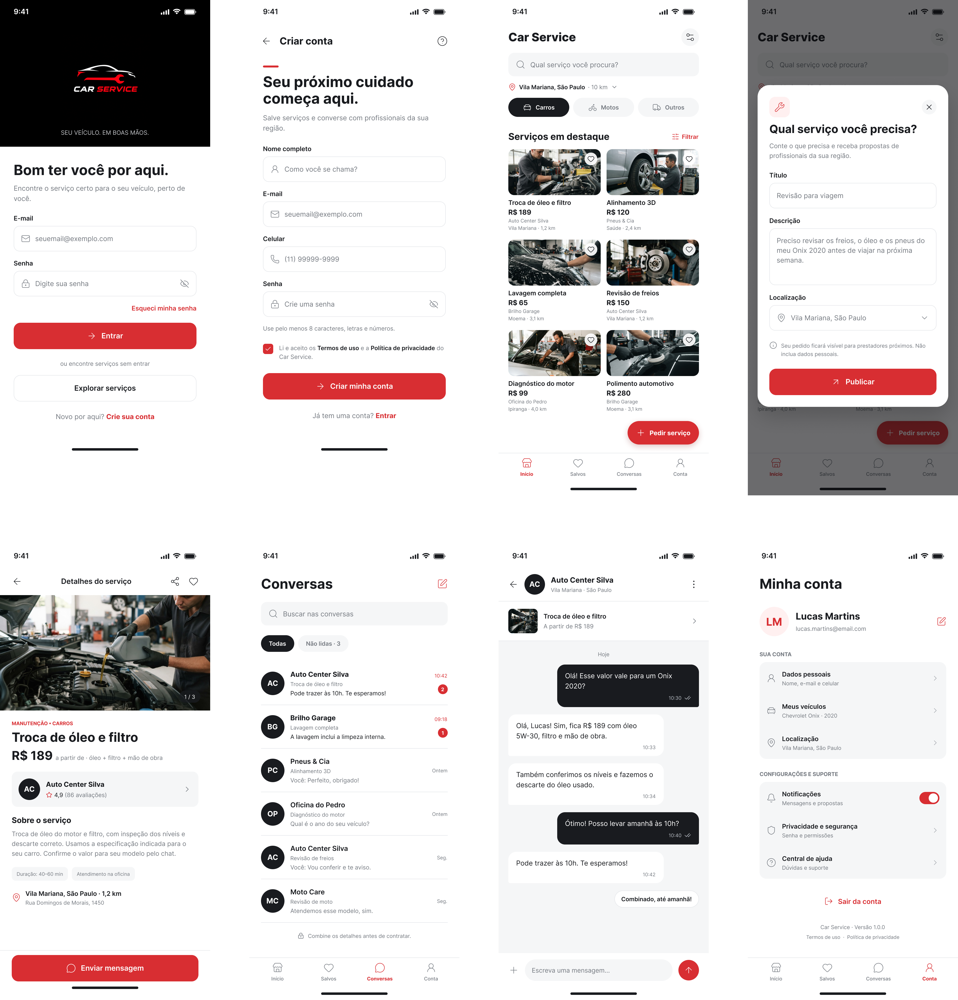

# Car Service

**Projeto da cadeira:** Interface Homem Computador

**Projeto conceito:** Aplicativo para serviços automotivos

**Instituição:** FSG

**Autor:** Manoel Rodrigues

O **Car Service** é um protótipo de aplicativo mobile que reúne serviços automotivos em uma interface simples. A proposta é facilitar a busca por serviços na região do usuário, a consulta de informações sobre os prestadores e a organização dos cuidados com seus veículos.

Este projeto acadêmico transforma um design criado no Figma em uma aplicação navegável, desenvolvida com React e Vite. O foco está na experiência de uso, na organização das telas e na interação com os principais fluxos do aplicativo.

> Os serviços, prestadores, preços, avaliações, conversas e pedidos são fictícios. O app não realiza contratações, pagamentos ou contato com oficinas reais.

## Design no Figma

Referência visual original utilizada no desenvolvimento:



O protótipo usa um quadro de **430 × 932 pixels**, escalado para caber na janela. A identidade visual combina vermelho `#DC2B2F`, superfícies claras, tipografia Inter, ícones e elementos arredondados. Também há estilos para a preferência de tema escuro do sistema.

A implementação evoluiu a partir das telas acima: inclui modo visitante, mais serviços, filtros, escolha de localização, cadastro de veículos, edição de dados pessoais e telas de privacidade e ajuda.

## Objetivo do projeto

Explorar conceitos da disciplina de Interface Homem Computador por meio de uma aplicação que permita:

- Encontrar serviços de manutenção, pneus, lavagem, elétrica e outras categorias.
- Consultar preço, descrição, duração e informações do prestador antes de iniciar uma conversa.
- Separar a exploração do catálogo das ações vinculadas a uma conta.
- Cadastrar dados pessoais e veículos em formulários com validação e retorno sobre as ações.
- Controlar a localização da busca e gerenciar os dados salvos no navegador.

## Funcionalidades

### Exploração como visitante

O botão **Explorar serviços** permite acessar o catálogo sem entrar na conta padrão ou na conta salva. O visitante pode buscar e filtrar serviços, visualizar detalhes, alterar a região da busca e consultar a Central de ajuda.

As áreas de dados pessoais, veículos, privacidade da conta, favoritos, conversas e pedidos apresentam opções para entrar ou criar conta. A localização escolhida pelo visitante fica apenas na sessão e não altera a localização salva de uma conta.

### Catálogo e filtros

- **64 serviços de exemplo:** 50 de carros, 8 de motos e 6 na categoria Outros.
- Busca por nome de serviço ou prestador, sem diferenciar letras maiúsculas ou acentos.
- Seleção de tipo de veículo: **Carros**, **Motos** e **Outros**.
- Modal com múltiplos filtros: **óleo e filtros, pneus, lavagem, elétrica, mecânica, freios, estética e transporte**.
- Contagem de resultados, aplicação e limpeza dos filtros.
- Cabeçalho e seleção de veículos fixos; rolagem somente na lista de serviços em destaque.
- Fotos locais dos serviços, reutilizadas por tipo de atendimento.

### Localização e serviços por região

O usuário pode pesquisar as regiões disponíveis, escolher um raio de **2, 5, 10, 20 ou 50 km** ou solicitar a localização do dispositivo.

Cada região escolhida recebe um catálogo fictício com variações de prestadores, preços, avaliações, distâncias e ordem das ofertas. A geração é estável por região: retornar ao mesmo local mantém as ofertas; mudar somente o raio filtra a lista existente. A região padrão mantém o catálogo inicial de São Paulo.

As distâncias são ilustrativas, calculadas a partir de coordenadas aproximadas ou geradas para o protótipo. O uso da localização automática depende da autorização do navegador e de HTTPS ou `localhost`.

### Serviços, favoritos e conversas

A tela de detalhes apresenta foto, preço, descrição, duração, prestador e localização. Após entrar, é possível salvar ou remover favoritos e abrir uma conversa relacionada ao serviço.

As conversas incluem busca, filtro de não lidas, envio local de mensagens e uma resposta rápida. Abrir uma conversa remove sua marcação de não lida. Não há envio de mensagens a terceiros.

O botão **Pedir serviço** abre um formulário com título, descrição e localização. A publicação valida os campos e mostra uma confirmação de demonstração.

### Minha conta

- **Dados pessoais:** cadastrar e editar nome, e-mail e celular com DDD.
- **Meus veículos:** adicionar, editar e remover carros, motos e outros veículos; informar marca, modelo, ano, cor e placa opcional.
- **Validações:** campos obrigatórios, formato de e-mail e celular, ano do veículo, formato de placa e placas duplicadas.
- **Localização:** acessar o mesmo seletor utilizado na busca e nos pedidos.
- **Notificações:** ativar ou desativar o indicador de mensagens não lidas na barra de abas. Não são notificações push.
- **Sair da conta:** encerrar a sessão sem apagar os dados cadastrados.

### Privacidade e segurança

Uma tela própria reúne as informações sobre armazenamento e os controles para:

- Permitir ou desativar a opção de localização automática.
- Exportar um backup `carservice-conta.json`.
- Importar um JSON válido, revisando os dados antes de confirmar a substituição.
- Apagar os dados locais mediante confirmação.

### Central de ajuda

A ajuda oferece perguntas frequentes expansíveis, busca sem diferenciação de acentos e atalhos para veículos, localização e privacidade. Também explica os limites do protótipo.

## Tecnologias

| Tecnologia | Uso |
| --- | --- |
| React 18 | Componentes, estado e interação entre telas |
| Vite 5 | Servidor de desenvolvimento e build |
| JavaScript / JSX | Lógica e estrutura das interfaces |
| CSS puro | Estilos globais, componentes e páginas |
| JSON / localStorage | Dados locais da conta e backups |
| Geolocation API | Localização do dispositivo, mediante permissão |

A aplicação não utiliza backend, banco de dados remoto ou React Router. A navegação é controlada por estado em `App.jsx`.

## Como executar

### Pré-requisitos

- Node.js **18 ou superior**, compatível com a versão do Vite utilizada.
- npm.
- Git para clonar o repositório.

### Instalação

```bash
git clone https://github.com/manoeldr/carservice-app.git
cd carservice-app
npm install
npm run dev
```

Abra o endereço informado pelo terminal, normalmente **http://localhost:5173**. Se essa porta estiver ocupada, o Vite poderá informar outra.

> Execute os comandos dentro da pasta `carservice-app`, onde está o arquivo `package.json`. Mantenha o terminal aberto durante o uso e pressione `Ctrl + C` para encerrar o servidor.

### Build de produção

```bash
npm run build
```

Os arquivos de produção são gerados em `dist/`.

Para visualizar esse build localmente:

```bash
npm run preview
```

## Como os dados são salvos

Dados pessoais, veículos, preferências e localização da conta são serializados em JSON no `localStorage`, na chave `carservice.account.v1`. Esses dados permanecem após recarregar a página no mesmo navegador e endereço de acesso.

Para obter uma cópia em arquivo, use **Minha conta → Privacidade e segurança → Exportar dados (.json)**. Para restaurar em outro navegador, utilize **Importar backup (.json)** e confira a revisão antes de confirmar.

| Informação | Armazenamento |
| --- | --- |
| Dados pessoais, veículos e preferências | JSON no navegador; incluídos no backup exportado |
| Localização da conta | JSON no navegador; incluída no backup exportado |
| Localização do visitante | Apenas durante a sessão |
| Favoritos e mensagens | Apenas durante a sessão; reiniciam ao recarregar |
| Senhas | Não são armazenadas |
| Pedidos publicados | Apenas confirmação visual de demonstração |

**Não há gravação automática de arquivos no servidor ou no repositório.** O arquivo `src/data/account-defaults.json` contém somente o perfil fictício inicial; ele não é alterado quando alguém cadastra dados no app.

O acesso com conta é uma simulação local, sem autenticação real ou múltiplas contas isoladas. A separação entre visitante e conta organiza os fluxos de interface e não substitui um sistema de autenticação de produção.

## Estrutura do projeto

```text
carservice-app/
├── docs/
│   └── design-figma.png          Referência visual original
├── public/
│   └── fotos/                   Fotos locais e créditos
├── src/
│   ├── App.jsx                  Estado, sessão e navegação
│   ├── main.jsx                 Entrada da aplicação
│   ├── Pages/                   Telas com exports nomeados
│   ├── Components/              Componentes compartilhados
│   ├── Styles/                  CSS global e por tela/componente
│   ├── data/                    Catálogo, regiões, ajuda e JSON inicial
│   └── Utils/
│       └── accountStorage.js    Validação, persistência e backup JSON
├── index.html
├── package.json
├── package-lock.json
└── vite.config.js
```

Cada página tem seu arquivo `.jsx` em `Pages/` e seu `.css` em `Styles/`. Estilos compartilhados ficam em `Styles/global.css`. `App.jsx` é o único componente com `export default`.

## Cuidados de interface e interação

- Navegação principal por abas, com indicação visual da seção ativa.
- Busca e filtros disponíveis acima da área de rolagem do catálogo.
- Mensagens de validação, estados vazios e confirmação das ações.
- Confirmação antes de excluir veículos ou apagar os dados da conta.
- Rótulos de formulário e nomes acessíveis nos controles.
- Navegação por teclado, fechamento de modais com `Esc` e gerenciamento de foco nos seletores de filtros e localização.
- Fotos relacionadas aos serviços e identidade visual consistente entre as telas.

Esses recursos fazem parte da proposta de IHC. O projeto não representa uma auditoria formal de acessibilidade ou uma avaliação de usabilidade com participantes.

## Imagens e créditos

A imagem do design é a referência do projeto fornecida pelo autor. As fotos dos serviços foram obtidas no Pexels e são usadas conforme a [licença do Pexels](https://www.pexels.com/license/).

Autores e links de cada foto estão em [public/fotos/CREDITOS.md](public/fotos/CREDITOS.md). As imagens são ilustrativas e não representam os prestadores fictícios do app.

## Possíveis evoluções

- Backend e autenticação real.
- Banco de dados para usuários, veículos, serviços, pedidos e mensagens.
- Integração com prestadores e dados geográficos reais.
- Persistência de favoritos e conversas.
- URLs por tela e navegação pelo histórico do navegador.
- Adaptação responsiva além do quadro mobile de referência.
- Testes de usabilidade com usuários e aprimoramento da acessibilidade.

## Repositório

[github.com/manoeldr/carservice-app](https://github.com/manoeldr/carservice-app)
