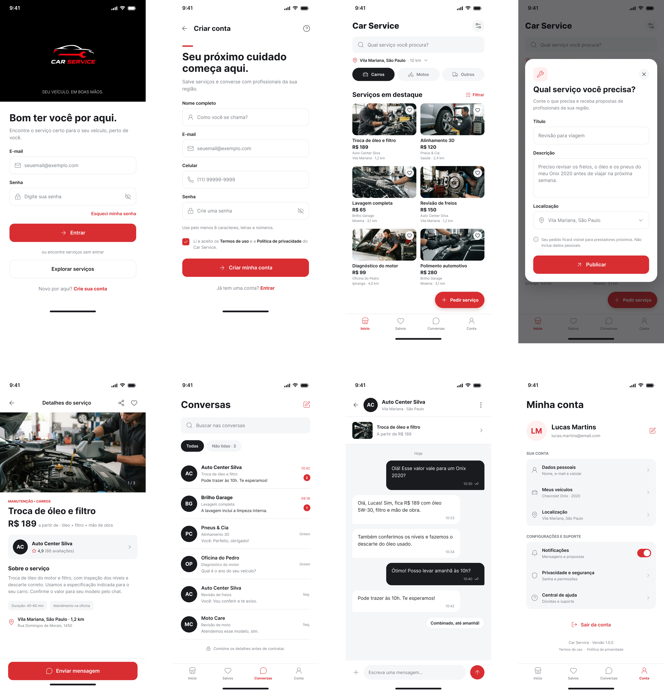

# Car Service

**Projeto da cadeira:** Interface Homem Computador

**Projeto conceito:** Aplicativo para serviços automotivos

**Instituição:** FSG

O **Car Service** é um protótipo de aplicativo mobile que reúne serviços automotivos em uma interface simples. A proposta é facilitar a busca por serviços na região do usuário, a consulta de informações sobre os prestadores e a organização dos cuidados com seus veículos.

Este projeto acadêmico transforma um design criado no Figma em uma aplicação navegável, desenvolvida com React e Vite. O foco está na experiência de uso, na organização das telas e na interação com os principais fluxos do aplicativo.

> Os serviços, prestadores, preços, avaliações, conversas e pedidos são fictícios. O app não realiza contratações, pagamentos ou contato com oficinas reais.

## Design no Figma

Referência visual original utilizada no desenvolvimento:



O protótipo usa um quadro de **430 × 932 pixels**, escalado para caber na janela. A identidade visual combina vermelho `#DC2B2F`, superfícies claras, tipografia Inter, ícones e elementos arredondados. Também há estilos para a preferência de tema escuro do sistema.

A implementação evoluiu a partir das telas acima: inclui modo visitante, mais serviços, filtros, escolha de localização, cadastro de veículos, edição de dados pessoais e telas de privacidade e ajuda.

## Objetivo do projeto

Explorar conceitos da disciplina de Interface Homem Computador por meio de uma aplicação que permita:

- Encontrar serviços de manutenção, pneus, lavagem, elétrica e outras categorias.
- Consultar preço, descrição, duração e informações do prestador antes de iniciar uma conversa.
- Separar a exploração do catálogo das ações vinculadas a uma conta.
- Cadastrar dados pessoais e veículos em formulários com validação e retorno sobre as ações.
- Controlar a localização da busca e gerenciar os dados salvos no navegador.

## Acessos de demonstração

| Perfil | E-mail | Senha |
| --- | --- | --- |
| Cliente | `cliente@email.com` | `cliente123` |
| Prestador | `prestador@email.com` | `prestador123` |

O login verifica a combinação de e-mail e senha e abre a tela inicial correspondente. Credenciais incorretas mostram um erro. **Explorar serviços** continua disponível como visitante, sem abrir nenhum perfil.

Cliente e prestador possuem dados pessoais, veículos, preferências, localização, favoritos e conversas separados. A principal diferença de interface está na tela inicial:

- **Cliente:** consulta o catálogo de ofertas e publica pedidos personalizados.
- **Prestador:** consulta pedidos de clientes por região, veículo e categoria; abre os detalhes e uma conversa; alterna para **Meus serviços** e publica suas ofertas.

Pedidos publicados pelo cliente aparecem para o prestador, e serviços publicados pelo prestador aparecem no catálogo do cliente, respeitando região, raio e filtros. As publicações são salvas no navegador e permanecem após recarregar. Abas abertas no mesmo navegador e endereço sincronizam o catálogo local.

Para testar, entre como cliente, publique um pedido, saia da conta e entre como prestador. Depois publique uma oferta e volte ao perfil cliente. Os mesmos dados estarão disponíveis se a região e os filtros forem compatíveis.

## Funcionalidades

### Exploração como visitante

O botão **Explorar serviços** permite acessar o catálogo sem entrar na conta padrão ou na conta salva. O visitante pode buscar e filtrar serviços, visualizar detalhes, alterar a região da busca e consultar a Central de ajuda.

As áreas de dados pessoais, veículos, privacidade da conta, favoritos, conversas e pedidos apresentam opções para entrar ou criar conta. A localização escolhida pelo visitante fica apenas na sessão e não altera a localização salva de uma conta.

### Catálogo e filtros

- **64 serviços de exemplo:** 50 de carros, 8 de motos e 6 na categoria Outros.
- Busca por nome de serviço ou prestador, sem diferenciar letras maiúsculas ou acentos.
- Seleção de tipo de veículo: **Carros**, **Motos** e **Outros**.
- Modal com múltiplos filtros: **óleo e filtros, pneus, lavagem, elétrica, mecânica, freios, estética e transporte**.
- Contagem de resultados, aplicação e limpeza dos filtros.
- Cabeçalho e seleção de veículos fixos; rolagem somente na lista de serviços em destaque.
- Fotos locais dos serviços, reutilizadas por tipo de atendimento.

### Localização e serviços por região

O usuário pode pesquisar as regiões disponíveis, escolher um raio de **2, 5, 10, 20 ou 50 km** ou solicitar a localização do dispositivo.

Cada região escolhida recebe um catálogo fictício com variações de prestadores, preços, avaliações, distâncias e ordem das ofertas. A geração é estável por região: retornar ao mesmo local mantém as ofertas; mudar somente o raio filtra a lista existente. A região padrão mantém o catálogo inicial de São Paulo.

As distâncias são ilustrativas, calculadas a partir de coordenadas aproximadas ou geradas para o protótipo. O uso da localização automática depende da autorização do navegador e de HTTPS ou `localhost`.

### Serviços, favoritos e conversas

A tela de detalhes apresenta foto, preço, descrição, duração, prestador e localização. Após entrar, é possível salvar ou remover favoritos e abrir uma conversa relacionada ao serviço.

As conversas incluem busca, filtro de não lidas, envio local de mensagens e uma resposta rápida. Abrir uma conversa remove sua marcação de não lida. Não há envio de mensagens a terceiros.

O botão **Pedir serviço** abre um formulário com título, descrição, tipo de veículo, categoria, veículo opcional e localização. Após a validação, o pedido é salvo no catálogo local e fica visível para o perfil prestador.

No início do prestador, **Publicar serviço** permite informar título, descrição, preço, duração opcional, tipo de veículo, categoria e localização. A oferta recebe uma foto ilustrativa da categoria e aparece em **Meus serviços** e no catálogo do cliente.

### Minha conta

- **Dados pessoais:** cadastrar e editar nome, e-mail e celular com DDD.
- **Meus veículos:** adicionar, editar e remover carros, motos e outros veículos; informar marca, modelo, ano, cor e placa opcional.
- **Validações:** campos obrigatórios, formato de e-mail e celular, ano do veículo, formato de placa e placas duplicadas.
- **Localização:** acessar o mesmo seletor utilizado na busca e nos pedidos.
- **Notificações:** ativar ou desativar o indicador de mensagens não lidas na barra de abas. Não são notificações push.
- **Sair da conta:** encerrar a sessão sem apagar os dados cadastrados.

### Privacidade e segurança

Uma tela própria reúne as informações sobre armazenamento e os controles para:

- Permitir ou desativar a opção de localização automática.
- Exportar um backup `carservice-conta.json`.
- Importar um JSON válido, revisando os dados antes de confirmar a substituição.
- Apagar os dados locais mediante confirmação.

### Central de ajuda

A ajuda oferece perguntas frequentes expansíveis, busca sem diferenciação de acentos e atalhos para veículos, localização e privacidade. Também explica os limites do protótipo.

## Gamificação, reputação e prioridade

O catálogo do cliente é ordenado por **reputação** por padrão. A pontuação combina **avaliações (70%)** e **atividade (30%)**. O cliente também pode escolher menor distância ou menor preço, mantendo os filtros de veículo, categoria e região.

Os prestadores recebem níveis e conquistas:

| Nível | Requisitos |
| --- | --- |
| Bronze | Início da jornada |
| Prata | 65 pontos, média de pelo menos 4 e 3 avaliações |
| Ouro | 85 pontos, média de pelo menos 4,5 e 5 avaliações |

O prestador consulta a pontuação, a composição, as regras, as conquistas e o histórico em **Minha conta → Minha reputação**, ou pelo selo na tela inicial.

### Pontos por participação

| Ação | Pontos de atividade | Limite |
| --- | --- | --- |
| Acessar o app em um novo dia | +5 | Uma vez por dia |
| Publicar um serviço | +10 | Até 3 publicações por dia |
| Primeira resposta a um pedido | +5 | Uma vez por pedido, até 5 por dia |
| Completar nome, e-mail e celular | +10 | Uma única vez |

A resposta precisa ter pelo menos 8 caracteres para registrar a participação. A atividade considera os últimos 30 dias, com teto de 100 pontos; a conquista de perfil completo permanece. Os prestadores do catálogo têm métricas iniciais fictícias para permitir a demonstração.

### Como a pontuação é calculada

A qualidade usa uma média ajustada pela quantidade de avaliações: são acrescentadas 5 avaliações de referência com nota 3,5 ao cálculo, para moderar o impacto de poucas avaliações. Esse resultado é convertido em até 70 pontos. Um prestador sem avaliações recebe zero nessa parcela.

A atividade inicial de demonstração é somada aos pontos das ações válidas. O total, limitado a 100, é convertido em até 30 pontos. A soma das duas parcelas produz a reputação de 0 a 100. Em caso de empate no catálogo, a menor distância tem preferência.

O cliente pode avaliar um prestador de 1 a 5 estrelas e deixar um comentário nos detalhes de um serviço. Cada perfil cliente tem uma avaliação por prestador; editar substitui a anterior, e todos os serviços do mesmo prestador usam a mesma reputação. As avaliações são de demonstração, sem validação de uma contratação real.

A prioridade dá **destaque nas buscas dos clientes**. Os pedidos continuam disponíveis para todos os prestadores da região, sem exclusividade ou promessa de contratação.

Os eventos e avaliações ficam em JSON na chave `carservice.reputation.v1` do `localStorage`. A reputação é compartilhada entre os perfis locais e sincroniza entre abas do mesmo navegador/endereço. Não faz parte do backup de dados pessoais, e permanece quando um perfil volta aos dados de exemplo.

Arquivos principais: `src/data/reputationRules.js`, `src/Utils/reputation.js`, `src/Utils/reputationStorage.js` e `src/Pages/Reputation.jsx`.

## Tecnologias

| Tecnologia | Uso |
| --- | --- |
| React 18 | Componentes, estado e interação entre telas |
| Vite 5 | Servidor de desenvolvimento e build |
| JavaScript / JSX | Lógica e estrutura das interfaces |
| CSS puro | Estilos globais, componentes e páginas |
| JSON / localStorage | Dados locais da conta e backups |
| Geolocation API | Localização do dispositivo, mediante permissão |

A aplicação não utiliza backend, banco de dados remoto ou React Router. A navegação é controlada por estado em `App.jsx`.

## Como executar

### Pré-requisitos

- Node.js **18 ou superior**, compatível com a versão do Vite utilizada.
- npm.
- Git para clonar o repositório.

### Instalação

```bash
git clone https://github.com/manoeldr/carservice-app.git
cd carservice-app
npm install
npm run dev
```

Abra o endereço informado pelo terminal, normalmente **http://localhost:5173**. Se essa porta estiver ocupada, o Vite poderá informar outra.

> Execute os comandos dentro da pasta `carservice-app`, onde está o arquivo `package.json`. Mantenha o terminal aberto durante o uso e pressione `Ctrl + C` para encerrar o servidor.

### Build de produção

```bash
npm run build
```

Os arquivos de produção são gerados em `dist/`.

Para visualizar esse build localmente:

```bash
npm run preview
```

## Apresentação no GitHub Pages

Endereço do app: **https://manoeldr.github.io/carservice-app/**

Em **Settings → Pages → Source**, selecione **GitHub Actions**. O workflow `.github/workflows/deploy.yml` instala as dependências, gera o build com base `/carservice-app/` e publica `dist/` após cada push na `main`.

Os caminhos das fotos usam a base do Vite para funcionar tanto localmente quanto no GitHub Pages. Para testar o mesmo build de publicação:

```bash
npm run build -- --base=/carservice-app/
npm run preview
```

Use o mesmo navegador e endereço para apresentar a troca entre cliente e prestador: os dados da demonstração são locais.

## Como os dados são salvos

Dados pessoais, veículos, preferências e localização da conta são serializados em JSON no `localStorage`. O cliente usa a chave `carservice.account.v1`; o prestador usa `carservice.account.provider.v1`. Backups incluem o tipo de perfil e só podem ser importados no perfil correspondente. Backups antigos de cliente continuam compatíveis. Esses dados permanecem após recarregar a página no mesmo navegador e endereço de acesso.

Para obter uma cópia em arquivo, use **Minha conta → Privacidade e segurança → Exportar dados (.json)**. Para restaurar em outro navegador, utilize **Importar backup (.json)** e confira a revisão antes de confirmar.

| Informação | Armazenamento |
| --- | --- |
| Dados pessoais, veículos e preferências | JSON no navegador; incluídos no backup exportado |
| Localização da conta | JSON no navegador; incluída no backup exportado |
| Localização do visitante | Apenas durante a sessão |
| Favoritos e mensagens | Apenas durante a sessão; reiniciam ao recarregar |
| Reputação, avaliações e eventos de atividade | JSON local compartilhado, separado do backup do perfil |
| Senhas | Não são armazenadas |
| Pedidos e ofertas publicados | JSON no navegador, compartilhado entre os dois perfis locais |

**Não há gravação automática de arquivos no servidor ou no repositório.** O arquivo `src/data/account-defaults.json` contém somente o perfil fictício inicial; ele não é alterado quando alguém cadastra dados no app.

Os acessos de cliente e prestador são uma simulação local, com credenciais públicas de demonstração validadas no frontend. Cada perfil tem armazenamento próprio; isso não substitui autenticação ou autorização em um backend de produção. O cadastro continua personalizando o perfil cliente de demonstração; os acessos para entrar são os da tabela acima.

As publicações usam a chave `carservice.marketplace.v1` e são compartilhadas apenas no mesmo navegador e endereço. Não há sincronização entre computadores ou navegadores diferentes. O backup do perfil não inclui o catálogo compartilhado; apagar os dados de um perfil preserva as publicações. As conversas continuam sendo simulações locais, sem envio a pessoas reais.

## Estrutura do projeto

```text
carservice-app/
├── docs/
│   └── design-figma.png          Referência visual original
├── public/
│   └── fotos/                   Fotos locais e créditos
├── src/
│   ├── App.jsx                  Estado, sessão e navegação
│   ├── main.jsx                 Entrada da aplicação
│   ├── Pages/                   Telas, incluindo Home e ProviderHome
│   ├── Components/              Componentes compartilhados
│   ├── Styles/                  CSS global e por tela/componente
│   ├── data/                    Catálogo, regiões, ajuda e JSON inicial
│   └── Utils/
│       ├── accountStorage.js    Perfis, validação e backup JSON
│       └── marketplaceStorage.js Pedidos e ofertas locais
├── index.html
├── package.json
├── package-lock.json
└── vite.config.js
```

Cada página tem seu arquivo `.jsx` em `Pages/` e seu `.css` em `Styles/`. Estilos compartilhados ficam em `Styles/global.css`. `App.jsx` é o único componente com `export default`.

## Cuidados de interface e interação

- Navegação principal por abas, com indicação visual da seção ativa.
- Busca e filtros disponíveis acima da área de rolagem do catálogo.
- Mensagens de validação, estados vazios e confirmação das ações.
- Confirmação antes de excluir veículos ou apagar os dados da conta.
- Rótulos de formulário e nomes acessíveis nos controles.
- Navegação por teclado, fechamento de modais com `Esc` e gerenciamento de foco nos seletores de filtros e localização.
- Fotos relacionadas aos serviços e identidade visual consistente entre as telas.

Esses recursos fazem parte da proposta de IHC. O projeto não representa uma auditoria formal de acessibilidade ou uma avaliação de usabilidade com participantes.

## Imagens e créditos

A imagem do design é a referência do projeto fornecida pelo autor. As fotos dos serviços foram obtidas no Pexels e são usadas conforme a [licença do Pexels](https://www.pexels.com/license/).

Autores e links de cada foto estão em [public/fotos/CREDITOS.md](public/fotos/CREDITOS.md). As imagens são ilustrativas e não representam os prestadores fictícios do app.

## Possíveis evoluções

- Backend e autenticação real.
- Banco de dados remoto para usuários, veículos, serviços, pedidos e mensagens.
- Integração com prestadores e dados geográficos reais.
- Persistência de favoritos e conversas.
- URLs por tela e navegação pelo histórico do navegador.
- Adaptação responsiva além do quadro mobile de referência.
- Testes de usabilidade com usuários e aprimoramento da acessibilidade.

## Repositório

[github.com/manoeldr/carservice-app](https://github.com/manoeldr/carservice-app)

## PWA e aplicativos Android/iOS

A interface usa o viewport real (`100dvh`), com largura máxima de 480px em computadores. No celular ocupa a tela disponível, respeita áreas seguras e mantém apenas a busca do catálogo fixa durante a rolagem. Título, localização, categorias, filtros e serviços rolam juntos; formulários e modais também podem rolar.

O PWA tem manifesto, ícones e service worker gerado pelo `vite-plugin-pwa`. Após o primeiro acesso online ao build publicado, os arquivos do aplicativo e fotos locais ficam disponíveis offline. A fonte externa pode cair para a fonte do sistema. Atualizações entram ao fechar as instâncias antigas e reabrir o aplicativo, sem forçar recarregamento de formulários.

- Android: abrir o site HTTPS no Chrome e usar **Instalar aplicativo / Adicionar à tela inicial**.
- iPhone: abrir no Safari, **Compartilhar → Adicionar à Tela de Início**.
- Para testar o PWA local: `npm run build` e `npm run preview`. O service worker não é ativado no servidor de desenvolvimento.

### Dados

Os perfis, publicações e reputação continuam serializados em JSON no `localStorage` do navegador ou WebView. O backup de conta em JSON continua disponível. Cada instalação/origem possui seu próprio armazenamento: navegador, PWA e app nativo não devem ser considerados sincronizados. Não existe servidor nem sincronização entre aparelhos; remover o aplicativo ou limpar seus dados pode apagar os registros. Conversas e favoritos continuam apenas em memória durante a sessão.

### Android (APK)

O projeto Capacitor fica em `android/`, com identificador `com.manoeldr.carservice`. Requer Node 22+, Android Studio/SDK e Java 21.

```bash
npm ci
npm run native:sync
npm run android:open
```

No Android Studio, aguardar a sincronização Gradle e gerar o APK pelo menu **Build → Generate App Bundles or APKs → Generate APKs**. Alternativamente, com SDK e Java configurados:

```bash
npm run android:apk
```

Saída: `android/app/build/outputs/apk/debug/app-debug.apk`. É um APK de depuração para demonstração. Distribuição em loja requer build release e assinatura própria.

Também foi incluído `.github/workflows/android-apk.yml`: após enviar os arquivos ao GitHub, abrir **Actions → Android APK de apresentação → Run workflow** e baixar o artifact `car-service-android-debug` ao concluir. Esse workflow ainda precisa ser executado para validar a compilação Android.

### iOS (iPhone/iPad)

O projeto nativo fica em `ios/`, usando Swift Package Manager. Requer macOS e **Xcode 26+** completo; somente Command Line Tools não basta.

```bash
npm ci
npm run native:sync
npm run ios:open
```

No Xcode, selecionar o target **App**, configurar a equipe em **Signing & Capabilities**, escolher o iPhone conectado ou um simulador e executar **Run**. Para distribuição, usar **Product → Archive** e o fluxo de assinatura/distribuição Apple. iOS não utiliza APK; a exportação assinada pode produzir um IPA conforme o método de distribuição disponível na conta Apple.

Sempre executar `npm run native:sync` após alterações web antes de recompilar os aplicativos. O build nativo usa caminhos relativos e arquivos locais; o deploy GitHub Pages mantém seu próprio comando com `--base=/carservice-app/`.

## Gestão do serviço e pontos por conclusão

No perfil **prestador**, abrir um pedido de cliente, tocar em **Conversar com cliente** e usar o menu de três pontos **Gerenciar serviço**:

1. **Aguardando aceite → Aceitar ou recusar**. A recusa tem confirmação e encerra esse atendimento.
2. **Aceito → Cancelar ou concluir**. O cancelamento exige justificativa de 10 a 500 caracteres, registrada com data no histórico da conversa.
3. **Concluir → Foto obrigatória**. Pode capturar pela câmera ou escolher JPG, PNG ou WebP da galeria. A foto é convertida para JPEG, redimensionada para até 1000px e comprimida antes de salvar.
4. Ao confirmar o comprovante, o serviço é concluído e gera **100 pontos**, uma única vez. Não é possível concluir novamente nem pontuar por recusa/cancelamento.

A validação da foto é **demonstrativa**, baseada apenas na presença de um arquivo de imagem legível. Não existe OCR, conferência de placa, aprovação por pessoa ou servidor. O usuário deve fotografar o veículo com a placa visível. A foto não é enviada pela internet.

Em **Conta → Pontos e recompensas**, o prestador vê saldo, histórico e benefícios fictícios de mobilidade (200 pontos), delivery (300) e acessórios (500). O resgate tem confirmação, desconta o saldo e gera um código `DEMO-…`, sem integração ou validade em parceiros reais. Esses pontos não são a nota de reputação usada para ordenar o catálogo.

Status, motivo, foto em base64, mensagens desses atendimentos e resgates ficam no JSON `carservice.orders.v1` do `localStorage`. O saldo é calculado pelas conclusões menos os resgates, sem crédito separado que possa duplicar ao reabrir. Os atendimentos voltam à lista de conversas após recarregar, mesmo que a região mude. Pedidos reais publicados pelo perfil cliente neste dispositivo também aparecem como conversas desse cliente; pedidos de clientes fictícios não são atribuídos a ele. Conversas antigas do catálogo continuam apenas na sessão.

Em caso de falta de espaço, o aplicativo informa o erro e mantém o estado anterior, sem concluir nem creditar pontos. O backup de conta não inclui os atendimentos/fotos/pontos. Limpar os dados do aplicativo remove os registros locais. A demonstração não possui proteção contra alteração manual do armazenamento nem validação antifraude.

Validações automatizadas das transições, comprovante, justificativa, saldo e resgate:

```bash
npm test
```
